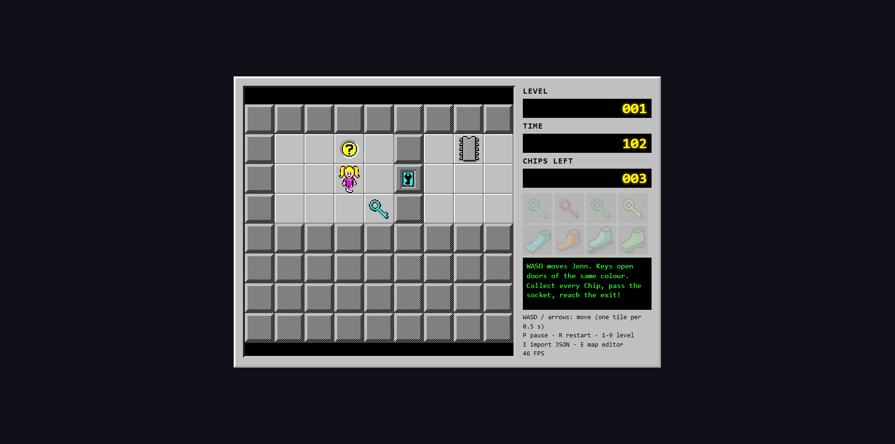
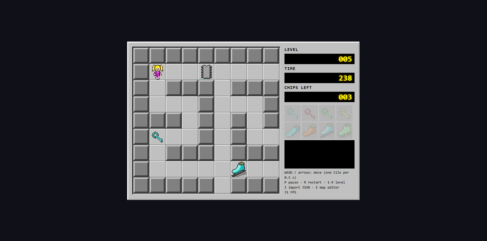
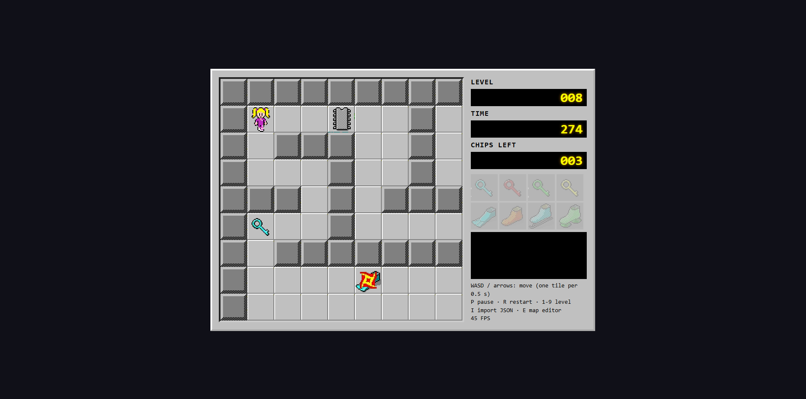
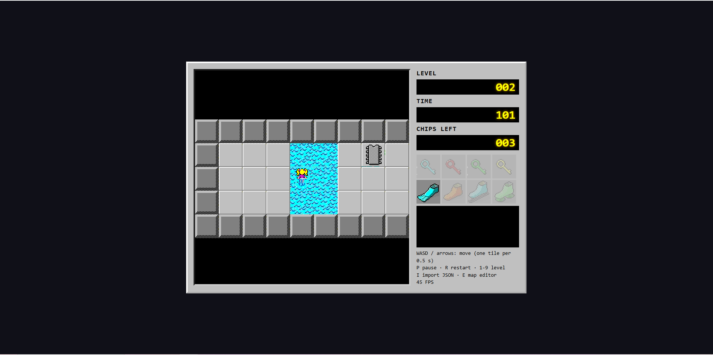
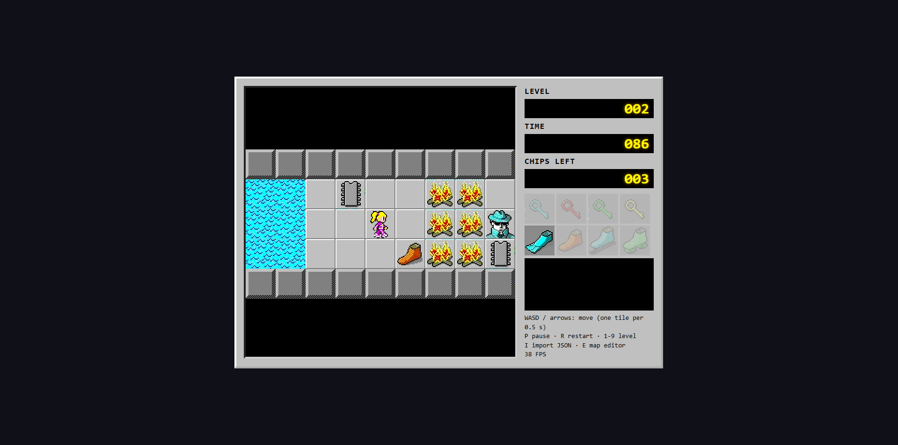

# Jenn's Challenge

## Screenshots taken from the game

### Level 001

### Level 005

### Level 008

More levels can be added via the map editor, some levels have been faithfully recreated, some features still needs to be added to make the full experience a reality, for now this is half of the game in it's entirety which is more than enough to have fun. Enjoy!

### Jenn swimming

### Jenn walking

This build fixes authored waypoint movement for Spider and tile-linked custom monsters.

## Authored monster paths
- Continuous/loop authored paths automatically start from the monster's actual spawn/current position.
- Spiders use their authored waypoint controller when authored paths are enabled.
- Tile-linked custom monsters use the same controller when they have waypoint data and are in loop/rail/path mode.
- Custom monsters without authored paths do not enter the path controller, so they cannot freeze merely because they are custom.
- Spider A* remains available when authored paths are disabled.

## Path traversal performance
Authored waypoint monsters use a cached short-segment route. A route is calculated once and its directions are consumed one tile at a time. Long waypoint segments are broken into small route chunks, so traversal cost is independent of the full 992x992 map size during normal movement.

The following values are available through `CC_MONSTER_CONFIG` for tuning:
- `pathRouteChunkTiles` (default 32)
- `pathRouteMarginTiles` (default 10)
- `pathRouteMaxSteps` (default 128)

If another actor occupies the next cached step, the route is invalidated and rebuilt from the monster's current position.
